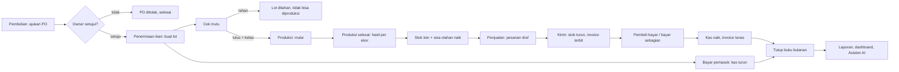
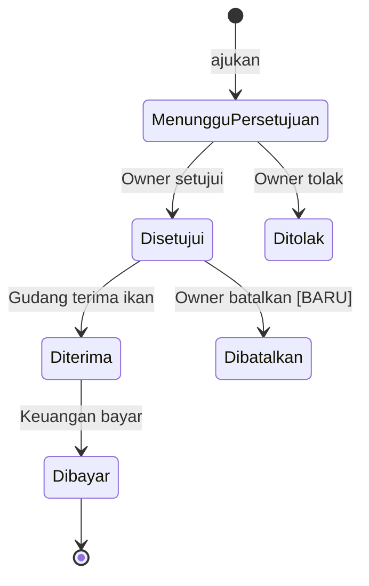
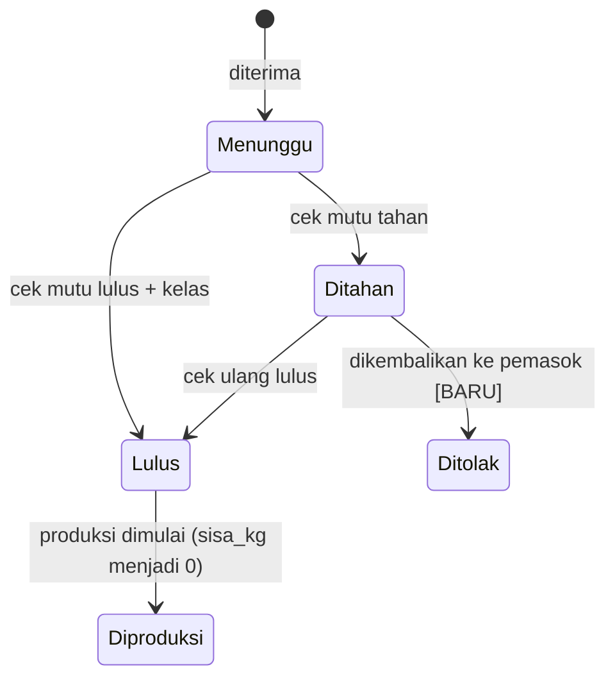
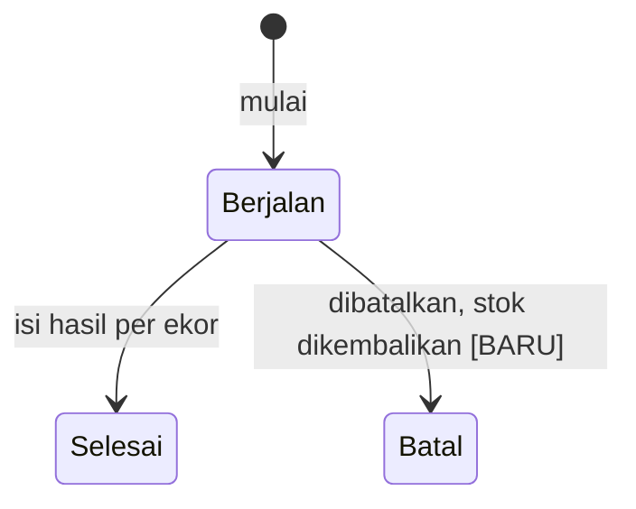
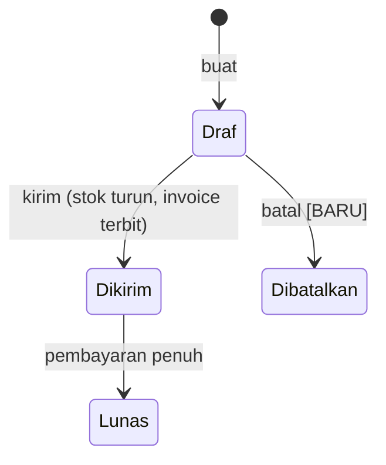
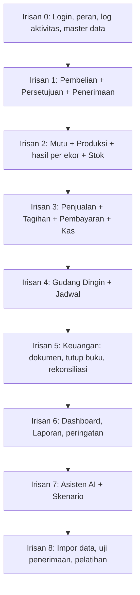

# Rencana Sistem KATALIS ERP: Fitur, Logika, dan Alur

> **Pembaruan 19 Okt 2026:** penawaran sudah disepakati dan catatan owner (rekaman Bungus Barat 5) sudah masuk. Rencana kerja yang berlaku ada di `rencana-eksekusi.md`. Bagian yang diganti di sana: jadwal, peran, model data produksi/stok/tarif, status persetujuan dan pembayaran, serta aturan susut.

Acuan untuk membangun sistem yang **sinkron antar modul dan siap beroperasi**. Fokusnya fungsi: apa yang dikerjakan tiap peran, urutan kejadian, aturan yang harus dijaga, dan dampak satu aksi ke modul lain. Infrastruktur (Vercel, Supabase, jadwal minggu) ada di `rancangan-pembangunan.md`.

Dasar: demo interaktif (`lib/demo/store.ts`) ditambah hal-hal yang **belum ada di demo tapi pasti muncul saat operasional nyata** (ditandai **[BARU]**). Bagian 12 berisi keputusan logika yang perlu disepakati dengan klien.

---

## 1. Prinsip agar semuanya sinkron

1. **Satu angka, satu sumber.** Tidak ada angka yang diketik dua kali. Dashboard, laporan, dan Asisten AI membaca dari sumber yang sama.
2. **Satu aksi = satu transaksi.** Menerima ikan sekaligus membuat lot, menambah stok, mengubah status PO, dan menulis log. Semuanya berhasil bersama atau batal bersama.
3. **Mutasi lewat fungsi, bukan tulis tabel langsung.** Setiap aksi punya satu fungsi yang memeriksa peran, status, dan aturan.
4. **Riwayat tidak dihapus.** Kesalahan diperbaiki dengan transaksi pembalik (reversal) atau koreksi bertanda, bukan hapus.
5. **Persetujuan sebelum dampak.** Pembelian, biaya, dan koreksi stok belum mengubah kas atau stok sampai Owner menyetujui.
6. **Periode terkunci tidak bisa diubah.** Setelah tutup buku, kas dan pembayaran periode itu beku.
7. **Status turunan dihitung, bukan diketik.** "Terlambat", "bentrok", "gudang penuh" dihitung dari data, tidak diedit manual.

**Sumber tiap angka utama**

| Angka | Sumber tunggal | Dipakai di |
|---|---|---|
| Stok ikan segar | `stock_movements` (jenis ikan_segar), per lot | Stok, Dashboard, Produksi |
| Stok loin / sisa olahan | `stock_movements` | Stok, Penjualan, Dashboard, AI |
| Saldo kas | jumlah `ledger` | Keuangan, Dashboard, Laporan, AI |
| Piutang | invoice belum lunas (jumlah − pembayaran) | Penjualan, Dashboard, Laporan |
| Isi gudang dingin | stok sendiri + titipan `disimpan` | Gudang Dingin, Stok, Dashboard |
| Hasil olahan | `production_fish` | Produksi, Dashboard, Laporan |
| Biaya per kg loin | biaya siklus ÷ kg loin | Laporan, Dashboard, Skenario |
| Bentrok jadwal | tumpang tindih `bookings` | Jadwal, Dashboard, AI |
| Kelengkapan dokumen | `documents` terhadap `ledger` | Keuangan, Tutup buku, Dashboard |

---

## 2. Peta alur utama

**Alur pendukung**
- **Gudang dingin:** titipan masuk → disimpan (kapasitas dihitung) → diambil → tagihan terbit sesuai tarif → dibayar → kas naik.
- **Biaya:** diajukan Keuangan → disetujui Owner → kas turun (periode terbuka) → dilampiri nota.
- **Koreksi stok:** diajukan Gudang → disetujui Owner → stok berubah + catatan mutasi.
- **Jadwal:** giliran mitra tetap + pesanan ABF → bentrok dicek → pindah ke jam kosong.
- **Tutup buku:** syarat dicek → periode terkunci → laporan final.

---

## 3. Mesin status (state machine)

Status hanya berubah lewat fungsi. Panah selain yang tertulis **ditolak**.

**Pembelian (PO)**

**Lot ikan**

**Produksi**

**Pesanan jual dan tagihan**

Invoice: `BelumJatuhTempo → JatuhTempo → Terlambat` (dihitung dari tanggal), `→ Lunas` bila total pembayaran ≥ jumlah. **[BARU]** `SebagianDibayar` bila 0 < pembayaran < jumlah.

**Titipan gudang dingin:** `Disimpan → Diambil` (tagihan terbit saat diambil). **[BARU]** `DiambilSebagian`.

**Persetujuan:** `Pending → Approved | Rejected`. Tidak bisa diubah setelah diputuskan.

**Periode:** `Terbuka → Terkunci → Terbuka (hanya Owner)`.

---

## 4. Matriks sinkronisasi: satu aksi, semua dampaknya

| Aksi | Tabel yang berubah | Dampak ke modul lain |
|---|---|---|
| Ajukan PO | `purchase_orders`, `approvals`, `activity_log` | Persetujuan: antrean +1; Dashboard "Perlu keputusan" +1 |
| Setujui PO | `approvals`, `purchase_orders` | Pembelian: tombol "Terima ikan" aktif |
| Tolak PO | `approvals`, `purchase_orders` | Antrean berkurang; riwayat mencatat alasan |
| Terima ikan | `lots`, `stock_movements` (+ikan segar), `purchase_orders` | Mutu: lot "menunggu"; Stok: ikan segar naik; Dashboard: total ikan diterima naik |
| Cek mutu lulus | `lots` | Produksi: lot muncul "siap diproduksi"; Dashboard: peringatan mutu hilang |
| Cek mutu tahan | `lots` | Dashboard: peringatan "belum lulus mutu" muncul |
| Mulai produksi | `productions`, `lots.sisa_kg=0`, `stock_movements` (−ikan segar) | Stok: ikan segar turun; Dashboard: aktivitas |
| Selesai produksi | `productions`, `production_fish`, `stock_movements` (+loin, +sisa olahan) | Stok naik; Penjualan: stok tersedia naik; Laporan hasil per ekor ikut; Dashboard hasil olahan ikut |
| Buat pesanan jual | `sales_orders` (draf) | Penjualan: stok "tersedia" turun (dikurangi pesanan draf) |
| Kirim pesanan | `sales_orders`, `stock_movements` (−loin), `invoices` | Stok loin turun; Piutang naik; Dashboard piutang ikut |
| Catat bayar pembeli | `ledger` (+), `payments`, `invoices`, `sales_orders` | Kas naik; Piutang turun; peringatan terlambat hilang bila lunas |
| Bayar pemasok | `ledger` (−), `purchase_orders` | Kas turun; syarat tutup buku "PO diterima sudah dibayar" terpenuhi |
| Titipan masuk | `cold_deposits` | Gudang dingin: isi naik; ditolak bila melebihi kapasitas; Dashboard persentase ikut |
| Titipan diambil | `cold_deposits`, `invoices` | Piutang naik (jenis gudang dingin) |
| Ajukan biaya | `approvals` | Antrean +1 |
| Setujui biaya | `ledger` (−), `approvals` | Kas turun; Laporan pengeluaran ikut; ditolak bila periode terkunci |
| Ajukan koreksi stok | `approvals` | Antrean +1 |
| Setujui koreksi | `stock_movements`, `approvals` | Stok berubah; catatan mutasi |
| Tambah/pindah jadwal | `bookings` | Bentrok dihitung ulang; Dashboard peringatan ikut |
| Unggah nota/bukti | `documents` | Kelengkapan dokumen naik; peringatan "belum ada bukti" turun |
| Tutup buku | `accounting_periods` | Kas dan pembayaran periode itu terkunci; laporan final |
| Buka kembali buku | `accounting_periods`, `activity_log` | Perubahan diizinkan lagi; tercatat siapa dan kapan |

Aturan kerja: **setiap baris di matriks ini menjadi satu uji otomatis** (bagian 10).

---

## 5. Spesifikasi fitur per modul

Format: **Tujuan**, **Alur**, **Aturan dan validasi**, **Kasus tepi**, **Peringatan**.

### 5.1 Dashboard Owner
- **Tujuan:** satu layar untuk memantau dan memutuskan.
- **Isi:** total ikan diterima, hasil olahan (rata-rata tertimbang), saldo kas, piutang, perlu keputusan, tagihan terlambat, gudang dingin terisi, stok loin; kartu Perlu Keputusan (dengan Setujui/Tolak langsung); kartu Perlu Perhatian; grafik hasil tiap ekor; aktivitas terbaru.
- **Aturan:** semua angka dibaca dari view. Tidak ada angka yang disimpan di dashboard. Angka diperbarui real-time bila data berubah.
- **Kasus tepi:** belum ada produksi (tampilkan "-", bukan 0%); data siklus berbeda (filter siklus **[BARU]**).

### 5.2 Persetujuan
- **Alur:** antrean menunjukkan jenis, ringkasan, jumlah, pengaju, tanggal, peringatan (mis. harga naik). Owner setujui atau tolak (alasan wajib).
- **Aturan:** hanya Owner yang memutuskan. Keputusan final. Menyetujui menjalankan dampak (PO jadi disetujui, kas turun, stok berubah) dalam satu transaksi.
- **Kasus tepi:** persetujuan biaya saat periode terkunci → ditolak dengan pesan jelas, persetujuan tetap pending; persetujuan koreksi stok yang membuat stok negatif → ditolak.
- **[BARU]** **Batas otomatis:** biaya kecil (di bawah ambang yang disepakati) bisa disetujui otomatis. Ambang diatur Owner.

### 5.3 Pembelian
- **Alur:** Pembelian pilih pemasok, isi kg dan harga/kg → sistem hitung total dan bandingkan dengan harga terakhir → ajukan → persetujuan → Gudang terima → Keuangan bayar.
- **Aturan:** kg dan harga > 0; peringatan bila harga naik dari harga terakhir; PO yang sudah diterima tidak bisa diubah (hanya dikoreksi lewat transaksi pembalik).
- **Kasus tepi:** **[BARU]** penerimaan sebagian (kg diterima < kg dipesan) → lot sesuai kg diterima, sisa PO tetap terbuka atau ditutup dengan alasan; **[BARU]** selisih timbang saat terima dicatat dan mempengaruhi total bayar; PO dibatalkan sebelum diterima.
- **Peringatan:** harga naik; PO diterima belum dibayar melewati N hari.

### 5.4 Mutu & Asal
- **Alur:** lot baru status Menunggu → Gudang cek mutu: lulus (pilih kelas A/B/C) atau tahan (alasan) → lot lulus siap diproduksi.
- **Aturan:** hanya lot lulus yang bisa diproduksi; kelas menentukan harga jual acuan; asal tercatat dari pemasok dan PO.
- **Penelusuran:** dari lot → produksi → stok → pesanan → pembeli, dan sebaliknya (pembeli → lot asal). Ini yang menjawab "produk bermasalah sulit dilacak".
- **Kasus tepi:** **[BARU]** lot ditahan lalu ditolak dan dikembalikan ke pemasok (stok ikan segar dikurangi, klaim ke pemasok dicatat).

### 5.5 Produksi
- **Alur:** pilih lot lulus → mulai (kg masuk = sisa lot) → saat selesai isi **hasil per ekor** (no ekor, kg utuh, kg loin) → sistem hitung hasil% per ekor dan total → stok loin dan sisa olahan naik.
- **Aturan:** hasil per ekor 40–80%; total loin = jumlah loin per ekor; sisa olahan dicatat terpisah; produksi selesai tidak bisa diubah (koreksi lewat pembalik).
- **Kasus tepi:** **[BARU]** produksi dari beberapa lot (diambil urut tanggal terima); **[BARU]** susut/limbah dicatat sebagai selisih (kg masuk − loin − sisa olahan) supaya neraca kg berimbang; produksi dibatalkan sebelum selesai (stok dikembalikan).
- **Peringatan:** ekor di bawah ambang (mis. <55%) ditandai; hasil rata-rata di bawah rencana 60%.

### 5.6 Stok
- **Alur:** tiga jenis stok (ikan segar, loin, sisa olahan) + stok gudang dingin. Semua perubahan lewat **mutasi** berpasangan (+/−) dengan alasan dan rujukan.
- **Aturan:** stok tidak boleh negatif; koreksi stok butuh persetujuan; stok tersedia untuk penjualan = stok loin − pesanan draf.
- **Rekonsiliasi:** hitung fisik periodik (opname) **[BARU]**: input kg fisik → selisih menjadi koreksi (ajukan persetujuan).
- **Kasus tepi:** dua pengguna menjual stok terakhir bersamaan → pengunci baris (lock) agar salah satu ditolak.

### 5.7 Penjualan dan Tagihan
- **Alur:** buat pesanan (pembeli, kg, harga/kg; acuan harga dari kelas) → kirim (stok turun, invoice terbit, jatuh tempo bawaan 14 hari atau sesuai pembeli) → catat pembayaran → lunas.
- **Aturan:** kg tidak melebihi stok tersedia; invoice = kg diterima × harga; pembayaran tidak boleh melebihi sisa tagihan; status terlambat dihitung otomatis dari jatuh tempo.
- **[BARU]** **Selisih berat kirim vs terima:** surat jalan mencatat berat kirim; pembeli mengonfirmasi berat diterima; invoice mengikuti berat diterima; selisih tercatat dan terlihat.
- **[BARU]** **Pembayaran sebagian** dan **retur/klaim** (kredit nota yang mengurangi invoice).
- **[BARU]** **Ongkos kirim per kiriman:** dicatat sebagai biaya langsung yang terhubung ke pesanan, jadi biaya per kg dan margin per pesanan bisa dihitung.
- **Pengingat:** Pembelian atau Keuangan kirim pengingat; tercatat di `reminders`.
- **Peringatan:** terlambat, jatuh tempo hari ini, selisih berat besar.

### 5.8 Gudang Dingin
- **Alur:** titipan masuk (pelanggan, kg) → disimpan → diambil (isi lama simpan) → tagihan terbit → dibayar. Pesanan ABF (pembekuan cepat) dihitung terpisah.
- **Aturan tarif (dari tabel `tariffs`):** ≤24 jam Rp75/kg; >24 jam sampai 10 hari ditagih **minimum 10 hari** × Rp75/kg; hari ke-11 dan seterusnya +Rp75/kg/hari, hari lanjutan dihitung penuh; ABF Rp3.500/kg dibekukan. Tarif transit ≤1 jam belum ditetapkan.
- **Kapasitas:** 17.500 kg total (stok sendiri + titipan). Titipan baru ditolak bila melebihi; peringatan di ≥85%.
- **[BARU]** Titipan diambil sebagian: tagihan proporsional, sisa tetap tersimpan dengan tanggal masuk awal.

### 5.9 Keuangan
- **Buku kas:** setiap uang masuk/keluar satu baris, dengan kategori, pihak, nota, bukti transfer, pemeriksa, penyetuju.
- **Alur biaya:** Keuangan ajukan → Owner setujui → tercatat. Tiap baris keluar wajib punya nota; bukti transfer wajib kecuali "tidak perlu".
- **Tutup buku:** syarat (a) tak ada persetujuan pending, (b) semua PO diterima sudah dibayar, (c) tak ada invoice terlambat, **[BARU]** (d) kelengkapan nota 100% dan bukti sesuai ambang, (e) stok tidak negatif. Bila lolos → periode terkunci.
- **[BARU]** **Rekonsiliasi bank:** saldo kas sistem dibandingkan saldo rekening; selisih ditampilkan sebelum tutup buku.
- **Biaya per kg dan margin:** dihitung dari biaya siklus (bagian 6).

### 5.10 Jadwal
- **Data tetap:** giliran CV DUS (Senin, Rabu, Jumat) dan PT SNS (Selasa, Kamis, Sabtu), 08.00–17.00, Sabtu sampai 12.00, 3.000 kg per hari penuh.
- **Alur:** pesanan ABF ditambahkan ke jam tertentu → sistem cek tumpang tindih dengan jadwal produksi mitra → bentrok ditandai dan bisa dipindah ke jam kosong pertama.
- **Aturan:** pesanan ABF di dalam jam kerja; pemindahan memilih slot kosong terdekat dalam minggu; log siapa memindah.
- **[BARU]** Mitra boleh melayani pihak lain (sesuai proposal): jadwal pihak lain tercatat dan ikut cek bentrok.

### 5.11 Skenario
- **Alur:** atur perubahan (harga ikan naik, harga jual turun, pemakaian mesin) → lihat dampak laba bulanan → simpan/muat.
- **Aturan:** hanya simulasi, tidak mengubah data nyata; label "perkiraan". Rumus diambil dari lembar asumsi yang disepakati (bagian 12).

### 5.12 Akses
- Owner mengundang pengguna, memberi peran, menonaktifkan. Tombol yang bukan tugas peran terkunci di tampilan **dan** ditolak di database. **[BARU]** Pengguna nonaktif tidak bisa masuk tetapi riwayatnya tetap ada.

### 5.13 Laporan
- Laba rugi, piutang menurut umur, stok, hasil per ekor, biaya siklus, pengeluaran fasilitas, riwayat aktivitas; unduh CSV. Semua dari view yang sama dengan dashboard, jadi angkanya identik.

### 5.14 Asisten AI
- Alat baca terbatas (piutang telat, saldo kas, hasil per ekor, jadwal bentrok, perlu persetujuan, isi gudang dingin, kelengkapan dokumen, biaya siklus). Berjalan dengan hak peran penanya. Jawaban menyertakan tautan ke modul dan menyebut bila data contoh.

---

## 6. Perhitungan (rumus yang harus sama di mana pun)

| Besaran | Rumus |
|---|---|
| Hasil olahan per ekor | `kg_loin ÷ kg_utuh × 100` |
| Hasil olahan rata-rata (tertimbang) | `Σ kg_loin ÷ Σ kg_utuh × 100` (Siklus 1: 62,6%) |
| Selisih terhadap rencana | `rata-rata − 60%` |
| Total PO | `kg × harga_per_kg` |
| Selisih harga | `harga_baru − harga_terakhir_pemasok` |
| Isi gudang dingin | `stok sendiri + Σ titipan disimpan` dibagi 17.500 |
| Tagihan gudang dingin | `kg × tarif_per_kg(hari)`, `tarif(hari) = 75 × max(hari, 10)`; ABF `kg × 3.500` |
| Umur piutang | `hari ini − jatuh_tempo` (negatif = belum jatuh tempo) |
| Piutang | `Σ (jumlah − pembayaran)` invoice belum lunas |
| Saldo kas | `Σ ledger` |
| Kelengkapan dokumen | `transaksi dengan nota ÷ total`, `dengan bukti ÷ (total − tidak perlu)` |
| Bentrok jadwal | `mulai_A < selesai_B` dan `mulai_B < selesai_A` pada hari yang sama |

**Biaya per kg loin (untuk laporan biaya siklus)**
1. Biaya siklus = biaya ikan utuh (harga beli × kg lot) + ongkos kirim + penanganan + kemasan + jasa (Siklus 1: Rp37,08 juta).
2. Biaya per kg loin = biaya siklus ÷ kg loin (Siklus 1: ±Rp123 ribu per kg; ongkos kirim saja ±Rp36.800 per kg).
3. Sisa olahan: **default usulan** nilai jualnya mengurangi biaya siklus (opsi lain: tidak dialokasikan). Perlu keputusan klien.
4. Margin = penjualan − biaya siklus; margin% = margin ÷ penjualan (Siklus 1: Rp4,50 juta, 10,8%).

**Entitas siklus [BARU]:** satu siklus mengelompokkan lot, produksi, biaya langsung, dan penjualan, supaya laporan "hasil dan biaya satu siklus" dan perbandingan antar siklus bisa dibuat.

---

## 7. Peringatan dan notifikasi

| Peringatan | Pemicu | Ke siapa | Tindakan cepat |
|---|---|---|---|
| Perlu keputusan | Ada approval pending | Owner | Setujui/Tolak |
| Harga beli naik | Harga PO > harga terakhir | Owner (di kartu) | Setujui/Tolak |
| Mutu belum lulus | Lot menunggu/ditahan > N jam | Owner, Gudang | Cek mutu |
| Hasil ekor rendah | Hasil < ambang | Owner | Buka Produksi |
| Tagihan jatuh tempo/terlambat | Tanggal | Owner, Keuangan, Pembelian | Ingatkan, catat bayar |
| Selisih berat kirim-terima | Selisih > ambang | Owner, Keuangan | Buka pesanan |
| Gudang dingin hampir penuh | ≥ 85% | Owner, Gudang | Buka Gudang Dingin |
| Jadwal bentrok | Tumpang tindih | Owner, Gudang | Pindah ke jam kosong |
| Bukti transfer belum ada | Transaksi keluar tanpa bukti | Keuangan, Owner | Unggah |
| Siap tutup buku | Syarat terpenuhi | Keuangan | Tutup buku |
| Stok mendekati nol **[BARU]** | Loin tersedia < ambang | Pembelian | Buat pesanan beli |

Saluran: di aplikasi (lencana dan daftar), dan opsional email atau WhatsApp (keputusan klien, biaya terpisah). Peringatan dihitung dari data (bukan disimpan), jadi hilang sendiri saat masalahnya selesai.

---

## 8. Kontrol dan rekonsiliasi (supaya tetap sinkron)

**Pemeriksaan otomatis tiap malam (job terjadwal):**
1. Hitung ulang status invoice (BelumJatuhTempo/JatuhTempo/Terlambat).
2. **Neraca kg:** `kg diterima − kg diproduksi = stok ikan segar`; `kg masuk produksi = loin + sisa olahan + susut`. Selisih ≠ 0 → peringatan ke Owner.
3. **Neraca kas:** saldo `ledger` = penjumlahan transaksi; tidak ada baris tanpa periode.
4. **Tautan:** invoice tanpa pesanan, lot tanpa PO, produksi tanpa lot → daftar anomali.
5. **Dokumen:** transaksi keluar tanpa nota.

**Pemeriksaan manual berkala:** opname stok fisik (mingguan), cocokkan saldo rekening (bulanan sebelum tutup buku).

**Integritas data:**
- **Konkurensi:** kolom `version` di tabel yang diubah banyak orang; update ditolak bila versi berubah ("data sudah diubah orang lain, muat ulang").
- **Idempotensi:** aksi yang bisa terkirim dua kali (klik ganda, jaringan putus) memakai kunci idempotensi supaya tidak membuat dua invoice atau dua pembayaran.
- **Pembatalan dengan pembalik:** membatalkan pengiriman membuat mutasi stok + dan invoice kredit, bukan menghapus.

---

## 9. Urutan pembangunan berdasarkan ketergantungan

Dibangun sebagai **irisan vertikal** (tiap irisan lengkap: database, aturan, layar desktop dan ponsel, uji), bukan per lapisan.

| Irisan | Keluaran yang bisa didemokan | Syarat lanjut |
|---|---|---|
| 0 | Pengguna masuk sesuai peran; tombol terkunci | Uji izin hijau |
| 1 | Beli → setujui → terima; stok ikan segar naik | Matriks baris 1–5 lulus |
| 2 | Lot lulus → produksi → hasil per ekor → stok loin | Neraca kg berimbang |
| 3 | Jual → kirim → bayar; kas dan piutang benar | Neraca kas dan piutang cocok |
| 4 | Titipan, tagihan tarif, bentrok jadwal | Contoh tarif sesuai proposal |
| 5 | Tutup buku dengan syarat; periode terkunci | Percobaan ubah ditolak |
| 6 | Dashboard dan laporan identik dengan modul | Uji "angka sama di semua tempat" |
| 7 | Asisten menjawab dari alat yang sama | Jawaban cocok dengan laporan |
| 8 | Data Siklus 1 dan Monitor Dana ter-impor | UAT disetujui |

Irisan 0–3 adalah **inti operasional**; bila waktu sempit, irisan 7 yang dikorbankan lebih dulu.

---

## 10. Pengujian sinkronisasi (kebenaran lintas modul)

**Uji ujung ke ujung (satu cerita, semua angka dicek di tiap modul):**
1. Beli 640 kg @ Rp45.500 → disetujui → diterima. Cek: stok ikan segar 640; total ikan diterima +640; PO diterima; kas belum berubah.
2. Cek mutu lulus kelas A → produksi 640 kg, hasil per ekor tersimpan. Cek: ikan segar 0; loin dan sisa olahan sesuai; dashboard hasil olahan = rata-rata tertimbang.
3. Jual 100 kg @ Rp135.000 → kirim. Cek: stok loin −100; piutang +Rp13,5 juta; invoice jatuh tempo +14 hari.
4. Bayar sebagian Rp5 juta lalu sisanya. Cek: status SebagianDibayar lalu Lunas; kas +Rp13,5 juta; piutang 0.
5. Bayar pemasok. Cek: kas −Rp29,12 juta; syarat tutup buku (b) terpenuhi.
6. Titipan 8.000 kg diambil hari ke-6. Cek: tagihan `8.000 × 75 × 10 = Rp6.000.000`.
7. Coba tutup buku dengan persetujuan pending → ditolak; selesaikan → berhasil; coba ubah kas → ditolak; Owner buka kembali → bisa lagi.

**Uji "angka sama di mana pun":** untuk tiap besaran di bagian 1 (saldo kas, piutang, stok loin, hasil olahan, isi gudang dingin), bandingkan nilai di modul, dashboard, laporan, CSV, dan jawaban Asisten AI. Harus identik.

**Uji penolakan:** stok negatif, jual melebihi stok, titipan melebihi kapasitas, bayar melebihi tagihan, hasil per ekor di luar 40–80%, aksi di luar izin peran, aksi di periode terkunci, persetujuan ganda.

**Uji konkurensi dan ulang:** dua pengguna menjual stok terakhir; klik ganda "Kirim"; jaringan putus di tengah aksi.

---

## 11. Kriteria siap beroperasi (fungsional)

- [ ] Semua state machine di bagian 3 diuji, termasuk transisi yang ditolak.
- [ ] Semua baris matriks sinkronisasi (bagian 4) punya uji otomatis yang lulus.
- [ ] Cerita ujung ke ujung (bagian 10) lulus dengan angka tepat.
- [ ] Neraca kg dan neraca kas dari job malam menunjukkan selisih nol pada data uji.
- [ ] Rumus di bagian 6 identik di dashboard, laporan, CSV, dan Asisten AI.
- [ ] Tutup buku: syarat dicek, periode terkunci, perubahan ditolak, buka kembali hanya Owner.
- [ ] Pembayaran sebagian, selisih berat, dan pembatalan dengan pembalik berfungsi **[BARU]**.
- [ ] Data Siklus 1 dan Monitor Dana ter-impor dengan selisih dilaporkan, bukan ditebak.
- [ ] Setiap peringatan di bagian 7 muncul dan hilang sesuai kondisi.
- [ ] Owner dan satu pengguna tiap peran menjalankan skenario UAT sendiri tanpa bantuan.

---

## 12. Keputusan logika yang perlu disepakati

| # | Pertanyaan | Usulan bawaan |
|---|---|---|
| 1 | Bagaimana biaya dialokasikan ke loin dan sisa olahan? | Seluruh biaya ke loin; nilai jual sisa olahan mengurangi biaya |
| 2 | Pembayaran sebagian dan retur/klaim dipakai? | Ya, ditambahkan |
| 3 | Berat yang ditagih: kirim atau terima? | Berat diterima pembeli (sesuai proposal) |
| 4 | Jatuh tempo tagihan: tetap 14 hari atau per pembeli? | Per pembeli, bawaan 14 hari |
| 5 | Ambang persetujuan otomatis untuk biaya kecil? | Tidak ada di awal; opsional |
| 6 | Penerimaan sebagian PO: sisa dibiarkan terbuka atau ditutup? | Ditutup dengan alasan, PO baru bila perlu |
| 7 | Produksi dari beberapa lot, urutan pengambilan? | Urut tanggal terima (paling lama dulu) |
| 8 | Siapa boleh membatalkan transaksi dan sampai kapan? | Owner; hanya di periode terbuka |
| 9 | Tarif transit ≤1 jam dan pembulatan hari | Menunggu ketetapan klien |
| 10 | Apa itu satu "siklus" dan siapa membukanya? | Dibuka Gudang saat penerimaan pertama, ditutup Owner |
| 11 | Satu pengguna boleh punya beberapa peran? | Tidak; satu peran utama |
| 12 | Rumus laba Skenario dan angka dasarnya | Mengikuti lembar asumsi proposal, disahkan klien |
| 13 | Kanal notifikasi di luar aplikasi (email, WhatsApp)? | Hanya di aplikasi dulu |
| 14 | Ambang peringatan (hasil ekor rendah, selisih berat, stok menipis) | Hasil <55%, selisih >2%, stok < kebutuhan 1 hari |

Keputusan ini perlu dikunci di minggu pertama karena mempengaruhi tabel, aturan, dan uji. Perubahan setelah itu masuk permintaan perubahan.

---

## 13. Yang sudah ada di demo vs yang perlu ditambah

| Sudah ada di demo | Perlu ditambah untuk operasional |
|---|---|
| Alur beli → setujui → terima → mutu → produksi → jual → bayar → tutup buku | Pembayaran sebagian, retur/klaim, pembatalan dengan pembalik |
| Hasil per ekor (data tetap Siklus 1) | Input hasil per ekor saat produksi, neraca kg dan susut |
| Tagihan gudang dingin dari tarif | Pengambilan sebagian, tarif dari tabel yang bisa diubah |
| Cek bentrok dan pindah ke jam kosong | Jadwal pihak lain, kalender per tanggal (bukan hanya per hari) |
| Peran dan izin (di tampilan) | Penegakan di database + pengguna nyata |
| Penyimpanan di browser | Data bersama multi-pengguna dengan konkurensi |
| Asisten AI pencocokan kata | Alat baca terbatas yang memakai hak peran |
| Kelengkapan dokumen (angka contoh) | Unggah nota/bukti dan hitung dari berkas nyata |
| Tutup buku dengan 3 syarat | Syarat tambahan, rekonsiliasi bank, job malam |
| — | Siklus, biaya langsung per kiriman, opname stok |
